# KOF98 Recomp

**The King of Fighters '98 running as a native PC program, in widescreen.** The game's 68000 code is statically recompiled to C and runs natively on a model of the Neo Geo hardware.

This is the first step of a bigger plan: bring the whole KOF series, from '94 to 2003, to the same treatment.

> **No game data here.** You need your own dumps of the game and the Neo Geo system ROM (MAME sets `kof98h` and `neogeo`). The recompiled C is generated from your dump, on your machine, at build time. It is never committed or distributed, and neither is anything else derived from the ROMs.

<p align="center">
  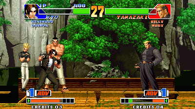<br>
  
</p>

## Screenshots

The same frames from the recompiled build, as the original 4:3 picture and in widescreen (`--headless --screenshot`, with and without `--widescreen`):

| Original (4:3) | Widescreen (16:9) |
|---|---|
| 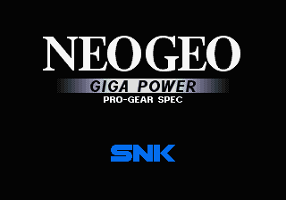 |  |
|  | 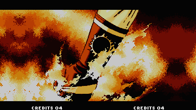 |
| 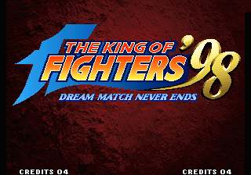 | 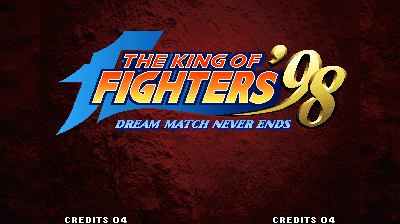 |
| 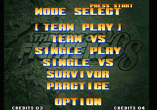 | 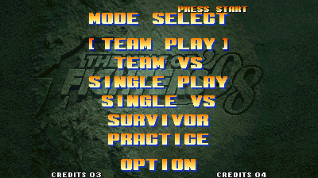 |
| 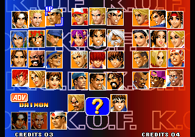 |  |
| 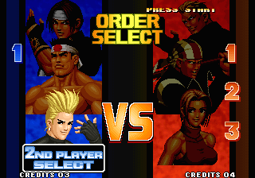 | 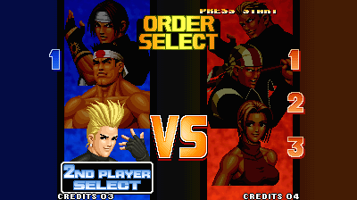 |
| 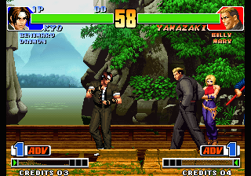 |  |

The stone behind the title and the menus uses new margin art ([below](#widescreen-art)).

## Why

KOF98 is one of the best fighting games ever made, and it still runs, at best, inside an emulator built for a 4:3 CRT. A static recompilation turns the game into a regular program: it can be changed, fixed and extended like any other code, while every recompiled block is checked against an interpreter so it stays faithful to the original. Widescreen was the first thing that needed it.

## Status

Alpha. **There is no sound yet.**

- Boots as an AES console, plays the intro, attract demos and team matches against the CPU, on recompiled code. The only interpreted code is a routine the game copies to RAM and runs once at boot.
- `--verify` replays every recompiled block in the Musashi interpreter: **0 mismatches** over 12.1M blocks of a 5-minute scripted session, and 11.7M in widescreen.
- **Widescreen** (`--widescreen`, 400×224; up to 480 with `--width`):
  - fights draw the stage across the whole width, on all nine stages, with the camera kept inside the stage art;
  - menus and other backgrounds continue into the margins in the game's own graphics: mirrored textures, repeated patterns, gradients carried on in their edge colour;
  - the stone behind the menus and the title has new margin art ([below](#widescreen-art)).
- Only player 1 has keys, and there is no gamepad support yet.

## What was done

KOF98 runs on [neogeorecomp](https://github.com/danilopaulinodasilva/neogeorecomp), a static recompilation toolkit for the Neo Geo by [sp00nznet](https://github.com/sp00nznet/neogeorecomp). This repo started as a fork of [metalslug](https://github.com/sp00nznet/metalslug), its reference game. Bringing up KOF98 took:

- **Banked program ROMs** in the toolkit: KOF98's program is 5 MB, with four 1 MB banks it switches between at runtime. Each bank is recompiled in its own context and dispatched by the bank that is mapped.
- **AES mode**: the AES cartridge refuses to run on an arcade (MVS) board, so it runs as the home console.
- **Widescreen**, which the hardware never had:
  - the game streams stage tiles for a 320-pixel window; patching 42 immediate operands at load time widens it, and narrows the camera range so the view never leaves the stage;
  - patched operands are read from memory by the recompiled code, so the same build runs at any width and `--verify` checks it;
  - screens drawn at a fixed 320 pixels get their margins filled from copies of their own sprite columns, or from art loaded from disk.

[docs/game-notes.md](docs/game-notes.md) has the details.

## Roadmap

1. **Sound**: YM2610 synthesis in the toolkit. The Z80 sound driver already runs, it just isn't heard.
2. **Player 2**, gamepads and remappable keys.
3. **More of KOF98 covered**: script versus, survivor, practice and the boss fight into the test sessions, so their code runs natively and is verified.
4. **The rest of the series**, one repo per game, the same way:
   - **KOF '94 to '97** first: they are unencrypted and close to '98, so they are expected to need mostly their ROM layout and their own widescreen patches;
   - then **KOF '99 to 2003**, which use encryption and protection chips, so the toolkit has to learn each scheme first.

[ROADMAP.md](ROADMAP.md) has the smaller items.

## Help wanted

This is a hobby project and help is very welcome. Useful things, roughly from easiest:

- **Play it and report problems**: what you did, what you expected, a screenshot or a `--record` clip. A scripted input file plus a frame number reproduces a run exactly.
- **Test the build on Windows and Linux**, especially `Setup.cmd`.
- **Sound**: YM2610 emulation in neogeorecomp is the biggest missing piece.
- **Reverse engineering** for the next games: ROM layouts, protection, and the background routines widescreen has to patch.

See [CONTRIBUTING.md](CONTRIBUTING.md) before sending code.

## Getting started

### Quick start (Windows)

> The Windows setup was carried over from the toolkit's reference game and hasn't been tried with KOF98 yet. If it trips, the step-by-step commands below work, and an issue saying where it stopped helps.

1. Download this repo: **Code → Download ZIP**, then unzip it. A `git clone` works too.
2. Put your **`kof98h.zip`** and **`neogeo.zip`** (MAME sets) in the unzipped folder, or in `Downloads`.
3. Double-click **`Setup.cmd`**.

   It checks for Git, CMake, the Visual Studio C++ build tools and SDL2, and asks before installing anything that's missing (it says what and how big). It finds and checksums your ROMs, recompiles and builds the game (a few minutes), and leaves a **KOF98** launcher in the folder. If something fails, it stops with one sentence on what to do and keeps the details in `setup.log`. Running it again picks up where it stopped.
4. Double-click **KOF98**.

**On Linux or macOS**, run `./setup.sh` instead, optionally with `--rom-zip PATH --bios-zip PATH`. It does the same steps and offers the `apt` command for anything missing. When it finishes, run `./kof98.sh`.

Keys: **arrows** move, **Z X C V** buttons A B C D, **1** start, **Esc** quit. It runs as an AES, so there are no coins: press start on the title screen. Start pauses during a round. For widescreen, run `./kof98.sh --widescreen`.

### Step by step

These are the commands `Setup.cmd` runs.

**Prerequisites:** Git; CMake 3.21+; a C compiler (Visual Studio 2022 with *Desktop development with C++* on Windows, gcc or clang elsewhere); SDL2 for the window (optional, since headless builds need nothing). On Linux: `sudo apt install git cmake gcc libsdl2-dev`. On macOS: `brew install cmake sdl2`.

1. **Clone with the toolkit submodule:**
   ```
   git clone --recurse-submodules https://github.com/danilopaulinodasilva/kof98recomp
   cd kof98recomp
   ```
2. **Unzip your ROMs into `roms/`.** From `kof98h.zip`: `242-pn1.bin 242-p2.bin 242-s1.bin 242-mg1.bin 242-c1.bin`..`242-c8.bin 242-v1.bin`..`242-v4.bin`. From `neogeo.zip` (or a non-merged `kof98h.zip`): `neo-po.bin sfix.sfix sm1.sm1 000-lo.lo`. [docs/game-notes.md](docs/game-notes.md) lists the CRC32s.
3. **Configure.** On Windows, point CMake at SDL2: vcpkg's toolchain file, or `-DSDL2_DIR=<SDL2-devel-VC>/cmake`.
   ```
   cmake -S . -B build -DKOF98_ROM_DIR=roms
   ```
4. **Build.** The generator recompiles your ROMs into `build/generated` first:
   ```
   cmake --build build --config Release
   ```
   Expected in the output:
   ```
   [m68krecomp] pointer scan: 38567 seeds
   [m68krecomp] kof98: 1555625 instructions emitted across routines
   [m68krecomp] 39917 routines, 57050 dispatch entries -> .../build/generated
   ```
5. **Profile (optional).** This plays two scripted sessions headless to find code only reached at runtime, then rebuilds with it:
   ```
   cmake --build build --config Release --target profile
   cmake --build build --config Release
   ```
6. **Play:**
   ```
   build/Release/kof98 --rom-path roms          (Linux/macOS: build/kof98)
   ```

Trip-ups:
- *`error: cannot open roms/242-pn1.bin`*: the ROMs are not in `roms/`, or you are running from a different folder. Pass `--rom-path`.
- *A "FOR USE WITH ORIGINAL SNK BOARDS ONLY" screen*: you ran it with an MVS system ROM (`--bios sp-s2.sp1`). Leave `--bios` out.
- *"Submodules missing"*: you cloned without `--recurse-submodules`. Run `git submodule update --init --recursive`.
- *No window, and "built without SDL2; run with --headless"*: CMake didn't find SDL2 (see step 3).

## Usage

```
kof98 --rom-path roms                                      # play
kof98 --rom-path roms --widescreen                         # play in 16:9
kof98 --headless --frames 4400 --input tests/start_fight.txt --record run.mp4
kof98 --headless --verify --frames 19000 --input tests/play_long.txt
kof98 --headless --interp --frames 4400 --screenshot 4350:interp.png
```

The toolkit's [docs/running.md](https://github.com/sp00nznet/neogeorecomp/blob/master/docs/running.md) covers every option and the input-script format. `tests/start_fight.txt` reaches the first round, and `tests/play_long.txt` is the 5-minute soak.

## Building from source

See *Step by step* above. `KOF98_ROM_DIR` is the only game-specific option. Without it, the build is interpreter-only, which is useful for working on the toolkit without regenerating.

## Widescreen art

Mirroring works for most backgrounds, but it shows on the stone textures behind the menus and the title. Those take their margins from new art, painted for this project, in `assets/`: indexed PNGs in each background's palette that hold only the margins. The game draws them through its own palette, so they fade and dim with the screen. To try your own, point `KOF98_ASSETS` at another folder. [docs/game-notes.md](docs/game-notes.md) has the formats.

## Documentation

- [docs/game-notes.md](docs/game-notes.md): the ROM set, what the game needed from the toolkit, and how widescreen works
- [neogeorecomp](https://github.com/danilopaulinodasilva/neogeorecomp): the toolkit's architecture and recompiler docs
- [CHANGELOG.md](CHANGELOG.md) · [ROADMAP.md](ROADMAP.md) · [CONTRIBUTING.md](CONTRIBUTING.md)

## Credits

- **[Danilo P. da Silva](https://github.com/danilopaulinodasilva)**: the project, KOF98, widescreen and its margin art.
- **[sp00nznet](https://github.com/sp00nznet)**: [neogeorecomp](https://github.com/sp00nznet/neogeorecomp) and [metalslug](https://github.com/sp00nznet/metalslug), the toolkit and the template this builds on.
- **[Claude Code](https://claude.com/claude-code)** (Anthropic): AI pair programmer for the reverse engineering, the toolkit changes and the widescreen work. Every change was tested by Danilo before it was pushed.
- Third-party code in the toolkit: [Musashi](https://github.com/kstenerud/Musashi) (68000 interpreter and `--verify` oracle), [z80](https://github.com/superzazu/z80) (sound CPU), [stb_image](https://github.com/nothings/stb) (PNG decoding).
- MAME's documentation of the hardware and of the ROM sets, used for reference only.

## License

The code in this repo is MIT ([LICENSE](LICENSE)). *The King of Fighters '98* is © SNK; this project contains none of its code or data and needs your own dump to do anything.
